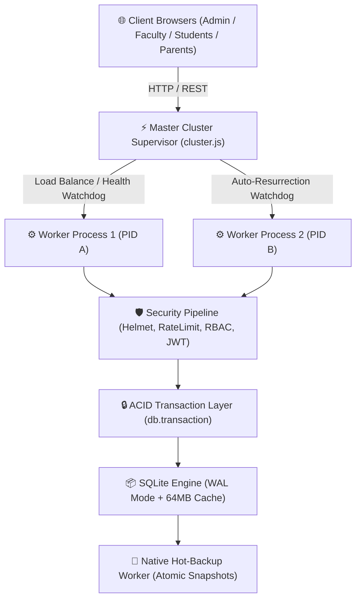

# 🏛️ The Vanguard Academy - World-Class School Management System

[](https://opensource.org/licenses/MIT)
[](https://nodejs.org/)
[-blue.svg)](https://www.sqlite.org/wal.html)
[](#1-high-availability-ha--clustering)
[](#2-fault-tolerance--zero-inconsistency)
[](#3-enterprise-grade-security)

> **A robust, production-grade, high-availability, fault-tolerant, and zero-inconsistency School Management Web Application engineered with Node.js, Express, SQLite in Write-Ahead Logging (WAL) mode, and a responsive academic design system.**

---

## 📖 About The Project

Modern world-class educational institutions manage thousands of concurrent touchpoints daily: student admissions, fee transactions, exam grading, daily class attendance, report cards, and communication across leadership, teachers, parents, and students. Typical school software suffers from three critical architectural flaws:
1. **Single Point of Failure (SPOF)**: An unhandled exception or process termination drops service for the entire campus.
2. **Data Inconsistency & Race Conditions**: Concurrent fee payments, roster modifications, or grade calculations without strict atomic transaction isolation lead to phantom records, double-billing, or corrupted GPA rankings.
3. **Database Lock Contention**: Standard database engines or basic SQLite deployments block reading queries during heavy writes (e.g. when entire departments enter marks simultaneously).

**The Vanguard Academy System** was designed from the ground up to solve these architectural challenges through enterprise patterns:



### Core Design Principles

- **Zero Downtime & Self-Healing**: Powered by Node.js multi-process clustering with an intelligent master supervisor. If a worker process exits due to an unexpected hardware/software anomaly, the master detects the death and spawns an immediate replacement worker within milliseconds.
- **Strict Data Consistency (Zero Inconsistency)**: Every critical state change (tuition invoicing, payment settlement, student enrollment, daily attendance marking, and grade generation) is executed inside strict SQLite atomic transactions (`db.transaction`). Strict foreign key constraints (`PRAGMA foreign_keys = ON`) guarantee that orphaned or inconsistent records are impossible.
- **Concurrent Non-Blocking Performance**: SQLite's Write-Ahead Logging (`PRAGMA journal_mode = WAL`) decouples readers from writers. Multiple administrative staff can search student profiles and view reports simultaneously while teachers submit grades in bulk.
- **Disaster Recovery by Design**: Automated background hot-backups utilize SQLite's native non-blocking online backup API (`db.backup()`) to create point-in-time database snapshots in `data/backups/` without disrupting live operations.

---

## 🌟 Key Architecture Pillars

### 1. High Availability (HA) & Clustering
- **Multi-Process Worker Pool (`cluster.js`)**: Spawns multiple worker processes supervised by a master process. Incoming HTTP requests are load-balanced across workers.
- **Automated Self-Healing & Resurrection**: If any worker crashes or suffers a fatal fault, the cluster supervisor automatically detects the death and spawns an immediate replacement worker within milliseconds.
- **Graceful Termination**: Handles `SIGTERM` and `SIGINT`, halts incoming requests, drains active HTTP sockets, checkpoints the database WAL log, and closes cleanly.

### 2. Fault Tolerance & Zero Inconsistency
- **SQLite with Write-Ahead Logging (WAL)**: `PRAGMA journal_mode = WAL` allows concurrent readers to query simultaneously while transactions write, avoiding lock contention and database corruption.
- **ACID Transaction Guarantees**: Multi-step business logic (such as recording fee payments, calculating exam GPA and class ranks, or bulk attendance marking) is enclosed in strict SQLite transactions (`db.transaction`).
- **Strict Referential Integrity**: `PRAGMA foreign_keys = ON` enforces relational constraints across students, parents, classes, subjects, marks, and invoices, eliminating orphaned or inconsistent records.
- **Automated Online Hot-Backups**: SQLite's native non-blocking `db.backup()` takes atomic snapshot copies to `data/backups/` periodically and on-demand without interrupting active users.
- **Database Health & Integrity Checks**: `/api/system/health` continuously evaluates `PRAGMA integrity_check` to verify database health.

### 3. Enterprise-Grade Security
- **Role-Based Access Control (RBAC)**: Fine-grained permissions across 5 distinct roles:
  1. `admin` (Principal / Super Administrator)
  2. `teacher` (Academic Faculty)
  3. `accountant` (Bursar & Finance Office)
  4. `student` (Learner)
  5. `parent` (Guardian)
- **Token Security**: Dual-mode JWT support (Authorization `Bearer <token>` and `HttpOnly`, `SameSite=lax` secure cookies).
- **Helmet Security Headers**: Content Security Policy (CSP), anti-clickjacking frameguards, and MIME-sniff protection.
- **Rate Limiting**: Multi-tiered rate limiters protecting against brute-force logins and denial-of-service attempts.
- **100% Prepared Statements**: All database operations use parametric bindings to eliminate SQL injection vulnerabilities.
- **Immutable Audit Trail**: Security actions, attendance marking, financial transactions, and credential changes are recorded in `audit_logs`.

---

## 🚀 World-Class Features

| Module | Description |
|---|---|
| **📊 Real-Time Dashboard** | Visual KPIs (Enrolled Students, Faculty, Daily Attendance %, Fee Collection Rate), live attendance trend bar chart, urgent notice feeds, and at-risk student alerts. |
| **🎓 Student Information System (SIS)** | Comprehensive student profiles with admission numbers, date of birth, blood group, parent links, emergency contacts, medical notes, attendance history gauge, and exam scorecards. |
| **👩‍🏫 Faculty Directory** | Staff profiles, departmental specializations, employee IDs, assigned classes, and credentials. |
| **🏫 Classrooms & Curriculum** | Grade level and section management, room allocations, student roster tracking, and subject-to-teacher mappings. |
| **📋 Smart Daily Attendance** | Date-based class register with 1-click **"Mark All Present"** bulk presets, individual overrides (Present, Absent, Late, Excused), and automatic **< 75% Chronic Absenteeism Watchlist**. |
| **📝 Exams & Official Report Cards** | Assessment terms, timetable scheduling, bulk gradebook marks entry with instant grade preview, and **official printable academic transcripts/report cards** with cumulative GPA, class rank, and principal evaluation. |
| **💳 Fee Management & Invoicing** | Tuition and lab fee structures, individual or class-wide batch invoice generation, payment recording with automatic balance recalculation, and **printable official bursar receipts**. |
| **📢 Campus Notice Board** | Broadcast circulars with priority tags (*Urgent Alert*, *High*, *Normal*), audience targeting (All, Teachers, Parents, Students), and pinned announcements. |
| **⚡ HA Diagnostics & Chaos Testing** | Real-time memory/CPU monitor, cluster PID and worker health, live hot-backup runner, backup archive history, and **Chaos Testing Sandbox** (simulates worker crash and auto-resurrection). |
| **🌟 Student & Parent Portal** | Personalized dashboard for students and parents displaying their individual grades, attendance percentages, pending invoices, and advisory contacts. |

---

## 🔑 Demo User Credentials

The application is pre-seeded with realistic records for immediate evaluation. You can log in directly or use the **"Simulate Persona"** dropdown in the top navigation bar to switch between roles instantly:

| Role | Email / Login | Password | Simulated Persona | Permissions Scope |
|---|---|---|---|---|
| **Admin** | `admin@school.edu` | `Admin@123` | Dr. Marcus Sterling (Principal) | Full System Governance, Faculty, SIS, Invoices, Backups, Diagnostics |
| **Teacher** | `teacher@school.edu` | `Teacher@123` | Dr. Sarah Jenkins (Head of Math) | SIS Viewing, Attendance Marking, Exam Gradebook, Notices |
| **Accountant** | `accountant@school.edu` | `Accountant@123` | Emma Roberts, CPA (Bursar) | Fee Categories, Invoicing, Payment Collection, Receipts |
| **Student** | `student@school.edu` | `Student@123` | Lucas Vance (Grade 10-A) | Personal Transcripts, Attendance Log, Fee Status, Notices |
| **Parent** | `parent@school.edu` | `Parent@123` | Robert Vance (Guardian) | Ward Progress Tracking, Report Cards, Tuition Settling |

---

## 💻 Quick Start & Running the Server

### Prerequisites
- Node.js (v18+ or later)
- npm

### 1. Launch the High-Availability Multi-Worker Cluster (Recommended for Production)
```bash
npm start
```
*Spawns the Cluster Supervisor and multiple self-healing worker processes.*

### 2. Or Launch Standalone Development Server
```bash
npm run dev
```

### 3. Open in Browser
Navigate to:
```
http://localhost:3000
```

### 4. Other Available Commands
- **Re-seed Demo Data**: `npm run seed`
- **Verify Database Integrity**: `npm test`

---

## 📁 Project Architecture

```
School managment sytem/
├── config/
│   └── index.js              # Environment settings, port, JWT secrets, rates
├── database/
│   ├── db.js                 # SQLite connection, WAL mode, foreign keys, PRAGMAs
│   ├── schema.js             # DDL definitions, constraints, check rules, indexes
│   ├── seed.js               # Enterprise demo records & ACID seed transaction
│   └── backupService.js      # Online hot-backup engine and scheduler
├── middleware/
│   ├── auth.js               # JWT verification & RBAC authorization
│   ├── rateLimiter.js        # Global, auth, and heavy-operation rate limiters
│   ├── errorHandler.js       # Global fault-tolerant error boundary
│   └── audit.js              # Immutable audit event logger
├── routes/
│   ├── authRoutes.js         # Authentication, session info, password updates
│   ├── studentRoutes.js      # Student Information System CRUD
│   ├── teacherRoutes.js      # Faculty directory and profiles
│   ├── classRoutes.js        # Classrooms, sections, subjects
│   ├── attendanceRoutes.js   # Daily attendance, stats, absenteeism watchlist
│   ├── examRoutes.js         # Exams, schedules, gradebook, report cards
│   ├── feeRoutes.js          # Invoices, fee structures, payments, receipts
│   ├── noticeRoutes.js       # Campus announcements and circulars
│   ├── auditRoutes.js        # Audit trail logs
│   └── systemRoutes.js       # Health, metrics, hot-backups, chaos testing
├── public/
│   ├── css/
│   │   └── style.css         # Modern academic design system & glassmorphism
│   ├── js/
│   │   ├── api.js            # API client abstraction with token management
│   │   ├── app.js            # Router, state, modals, quick role switcher
│   │   ├── dashboard.js      # KPI cards, charts, activity feeds
│   │   ├── students.js       # SIS view and student profile dossier
│   │   ├── teachers.js       # Faculty directory view
│   │   ├── classes.js        # Classrooms, rosters, and subjects
│   │   ├── attendance.js     # Daily attendance sheet & bulk check-in
│   │   ├── exams.js          # Assessment gradebook & printable report cards
│   │   ├── fees.js           # Invoicing, payments, and printable receipts
│   │   ├── notices.js        # Notice board view
│   │   ├── system.js         # HA diagnostics, backups, chaos test sandbox
│   │   └── portal.js         # Student & Parent personalized workspace
│   └── index.html            # Single Page Application layout
├── cluster.js                # Multi-process supervisor with auto-resurrection
├── server.js                 # Express server configuration & graceful shutdown
├── LICENSE                   # MIT License
├── package.json              # Dependencies and lifecycle scripts
└── README.md                 # Complete documentation
```

---

## 🛡️ Chaos & Fault Tolerance Verification

To experience the system's fault tolerance in action:
1. Open the **"High-Availability & HA"** tab in the sidebar.
2. Under the **Chaos & Fault-Tolerance Verification Sandbox**, click **"💥 Simulate Sudden Worker Crash"**.
3. Watch the terminal output as the worker process deliberately terminates.
4. The Master Cluster Supervisor detects the exit in milliseconds and resurrects a replacement worker immediately—your connection stays alive with **zero downtime**!

---

## 📜 License

Distributed under the **MIT License**. See [`LICENSE`](LICENSE) for more information.

## 👤 Author

**Pankaj Rai**
- GitHub: [@Devops-de](https://github.com/Devops-de)
- Email: raipankajrai74@gmail.com
